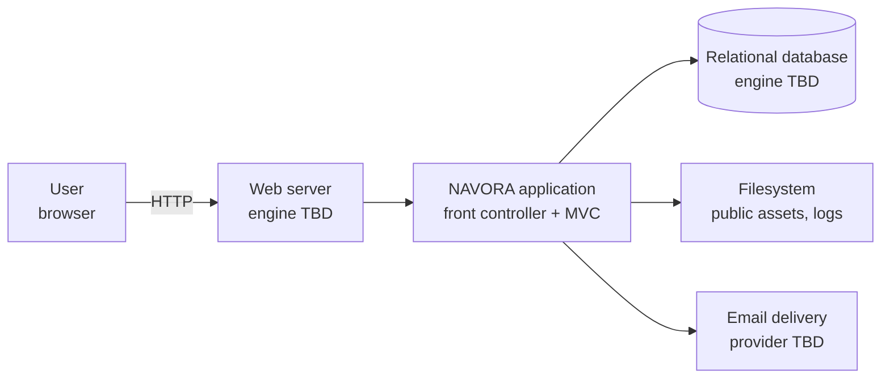

# NAVORA — Software Requirements Specification (SRS)

| Field | Value |
|---|---|
| Document ID | NAVORA-SRS |
| Version | 0.2.0 (Consolidated) |
| Date | 2026-11-22 |
| Status | **Owner-approved product decisions applied; stack items OPEN** |
| Basis | `SRC-00`, `SRC-01`, `PRD.md`, `BUSINESS-RULES.md`, `DECISIONS.md` |
| Audience | Implementers, reviewers, testers |

> **Scope note:** This SRS specifies *expected behavior*. Because the repository contains only empty placeholders, none of this behavior exists yet. Statements about current implementation are explicitly labeled.

---

## 1. System Context

| Element | Verified status | Notes |
|---|---|---|
| Browser client | Assumed | HTML + CSS + vanilla JS scaffold folders exist |
| Web server | `TBD` | `.htaccess` implies Apache; not verified |
| PHP runtime | `TBD` | PHP files exist; PHP is not installed in the audit environment |
| Database | `TBD` | `database/dayora.sql` exists but is empty; engine unknown |
| Email delivery | `OPEN` | Required by DEC-015 (verification, reset); provider `TECH-06` |

---

## 2. Actors

| Actor | Description | Access |
|---|---|---|
| Visitor | Unauthenticated user | Login, registration, password reset request |
| Registered user | Owner of a personal goal set | Own goals, transactions, archive, account |
| System | Computes balances, validates input, sends email, renders views | Internal |
| Administrator | **Not defined / out of scope** | No admin role exists |

Authentication is **required** (DEC-003). There is no single-user mode.

---

## 3. Assumptions and Dependencies

| ID | Statement | Status |
|---|---|---|
| AS-01 | The application is served from a single PHP entry point (`index.php`) with URL rewriting. | Inferred from scaffold |
| AS-02 | Views are server-rendered PHP templates. | Inferred |
| AS-03 | No JavaScript framework or build step is required. | Inferred (no manifest) |
| AS-04 | The database is relational (SQL dump present). | Inferred |
| AS-05 | Users enter savings manually. | Brief |
| AS-06 | Data volume per user is small. | Proposed |
| AS-07 | Email delivery is available for verification and password reset. | Approved behavior (DEC-015); provider `OPEN` |

Dependencies: `TECH-01` PHP version, `TECH-02` DB engine, `TECH-06` email provider, `TECH-09` hosting target — all `OPEN`.

---

## 4. Functional Behavior

### 4.1 Account Management

**SR-4.1.1 Register**
- Input: `name` (required), `email` (required, valid, unique), `password` (required, confirmation).
- Processing: trim → validate → hash password → persist user → send verification email.
- Output: HTTP 303 redirect to a "check your email" page or limited dashboard.
- Side effects: verification token created; email queued/sent.

**SR-4.1.2 Email verification**
- Input: token from the verification link.
- Processing: validate token (exists, not expired, not used) → mark email verified → invalidate token.
- Output: success page with a link to the dashboard; invalid/expired token shows a resend option.
- Open: whether login is blocked before verification (`OPEN-08`).

**SR-4.1.3 Login / logout**
- Login input: email + password.
- Processing: verify credentials with `password_verify()`; regenerate session ID; set session cookie.
- Logout: POST only, CSRF-protected; invalidate server-side session.
- Failure: generic message; no user enumeration.

**SR-4.1.4 Password reset**
- Request input: email. Always returns the same generic confirmation (no enumeration).
- Processing: create a time-limited, single-use token; send email.
- Completion input: token + new password + confirmation.
- Processing: validate token → update password hash → invalidate token → invalidate existing sessions.
- Open: token lifetime (`OPEN-09`).

### 4.2 Goal Management

**SR-4.2.1 Create goal**
- Input: `name` (required), `target_price` (required, whole IDR), `target_date` (optional, past allowed), `description` (optional, `OPEN-03`).
- Processing: trim → validate (including uniqueness per account) → persist → redirect to goal detail with success message.
- Output: HTTP 303 redirect on success; re-render with field errors on validation failure.
- Initial status: derived `Berlangsung` with zero balance.

**SR-4.2.2 List goals**
- Input: optional `q` (search), `sort`, `status`, `page`.
- Output: paginated list (20/page) of the user's non-archived goals, each with name, target, balance, progress, remaining, excess, status, Hampir Tercapai indicator.
- Empty result: empty state, not an empty table.
- Archived goals are excluded.

**SR-4.2.3 View goal**
- Input: goal identifier.
- Output: full goal data, balance (may be negative), progress, remaining, excess, recent transactions, actions.
- Not found, not owned, or archived (when not opened from the archive view): 404-equivalent response.

**SR-4.2.4 Update goal**
- Input: editable fields; unchanged fields may be omitted.
- Validation: same as creation, including uniqueness.
- Output: redirect with success message; errors re-rendered.
- Rule: target changes do not alter transactions (RULE-035); status and progress recomputed.

**SR-4.2.5 Archive goal**
- Input: goal identifier + confirmation token.
- Processing: set archived state; keep transactions; exclude from active lists and totals.
- Output: redirect to goals list with success message.
- Hard delete is not available.

**SR-4.2.6 Restore goal**
- Input: goal identifier + confirmation.
- Processing: clear archived state; goal returns to the active list with full history.
- Output: redirect to archive or goal detail with success message.

### 4.3 Savings Transactions

**SR-4.3.1 Add transaction**
- Input: `direction` (`Setoran` / `Penarikan`), `amount` (required, whole IDR > 0), `occurred_on` (required), `note` (optional, `OPEN-04`).
- Precondition: goal exists, is owned by the user, and is not archived (`OPEN-12`, proposal).
- Processing: validate → insert → recompute derived balance and status.
- Output: redirect back to goal detail with success message; the new balance is visible.
- Withdrawals may exceed the balance; negative balances are accepted.

**SR-4.3.2 List transactions**
- Input: goal identifier, `page`.
- Output: paginated table (numbered, 20/page), newest first, with direction, amount, date, note.
- Empty: empty state.

**SR-4.3.3 Update transaction** (`OPEN-01`)
- Input: direction, amount, date, note.
- Effect: balance and status recomputed.

**SR-4.3.4 Delete transaction** (`OPEN-02`)
- Input: transaction identifier + confirmation.
- Effect: balance and status recomputed; a `Tercapai` goal may return to `Berlangsung`.

### 4.4 Dashboard

- Aggregates (proposed set, `OPEN-06`): count of active goals, total saved across active goals, total remaining, goals in the Hampir Tercapai range, recent transactions.
- Archived goals are excluded from counts and totals (RULE-033).
- All values derived from the same source of truth as goal pages (no separate stored totals).
- With zero goals: onboarding empty state.

### 4.5 Status & Indicators

- `status = Tercapai` when `balance >= target_price`; otherwise `Berlangsung` (DEC-006).
- Status is recomputed after every transaction and target edit; no manual completion action.
- `Hampir Tercapai` when `90% <= progress < 100%` and not archived (DEC-012).
- Progress display is capped at 100%; excess is shown separately.

---

## 5. Input and Output Specifications

### 5.1 Inputs

| Input | Format | Required | Validation | Error output |
|---|---|---|---|---|
| User name | UTF-8 text | Yes | 1–80 chars after trim | "Nama wajib diisi" / "Nama terlalu panjang" |
| Email | Email address | Yes | Valid, unique, normalized | "Email tidak valid" / "Email sudah terdaftar" |
| Password | Secret text | Yes | Minimum length `OPEN-10` | "Kata sandi terlalu pendek" |
| Goal name | UTF-8 text | Yes | 1–80 chars, unique per account | "Nama goal wajib diisi" / "Nama goal sudah digunakan" |
| Target price | Integer string (IDR) | Yes | > 0; ≤ max (`OPEN`); digits only | "Masukkan nominal yang valid" / "Nominal harus lebih dari nol" |
| Target date | `YYYY-MM-DD` | No | Valid date; past allowed | "Masukkan tanggal yang valid" |
| Description | UTF-8 text | No | ≤ 500 chars (`OPEN-03`) | "Deskripsi terlalu panjang" |
| Transaction direction | Enum | Yes | `Setoran` or `Penarikan` | "Pilih jenis transaksi" |
| Transaction amount | Integer string (IDR) | Yes | > 0; ≤ max (`OPEN`); digits only | "Masukkan nominal yang valid" |
| Transaction date | `YYYY-MM-DD` | Yes | Valid; not future (proposal); WIB | "Tanggal tidak boleh di masa depan" |
| Note | UTF-8 text | No | ≤ 255 chars (`OPEN-04`) | "Catatan terlalu panjang" |
| Search query | UTF-8 text | No | ≤ 80 chars; trimmed | — |
| Page | Integer | No | ≥ 1; invalid → 1 | — |

### 5.2 Outputs

| Output | Format | Notes |
|---|---|---|
| HTML pages | Server-rendered HTML5 | Primary output; Bahasa Indonesia |
| Redirects | HTTP 303 (POST→GET) | Prevents duplicate submissions |
| Validation errors | Re-rendered form with messages | Values preserved except secrets |
| Flash messages | Session-backed, one render | Success/error |
| Error pages | HTML | 404, 419 (CSRF), 500 |
| Email | Plain text or HTML | Verification and reset links |
| Machine output | **None** | No JSON API in MVP (DEC-017) |

---

## 6. Validation Requirements

| ID | Requirement | Status |
|---|---|---|
| VR-01 | Validation occurs server-side for every write operation. | `APPROVED` (policy) |
| VR-02 | Client-side validation may supplement but never replace server-side checks. | `PROPOSED` |
| VR-03 | Numeric parsing rejects non-numeric characters, NaN, Infinity, empty strings, and decimal separators for IDR. | `APPROVED` (IDR) |
| VR-04 | Monetary comparisons use exact whole-rupiah integers. | `APPROVED` |
| VR-05 | All identifiers are validated as positive integers before use. | `PROPOSED` |
| VR-06 | Unknown or extra fields are ignored, never mass-assigned. | `PROPOSED` |
| VR-07 | Validation messages are associated with their fields and announced to assistive technology. | `PROPOSED` |
| VR-08 | Goal-name uniqueness is checked within the authenticated account, not globally. | `APPROVED` |

---

## 7. Error Handling

| Condition | Expected behavior | User-visible result |
|---|---|---|
| Invalid form input | Re-render form, preserve valid input, mark invalid fields | Field-level messages |
| Missing/invalid record ID | Do not leak existence | 404 page |
| Unauthorized record access | Same as not found | 404 page |
| CSRF token invalid/expired | Reject request | 419 page with retry guidance |
| Database connection failure | Log details; show generic message | 500 page |
| Constraint violation | Log; show generic message | 500 page or inline error if recoverable |
| Duplicate submission | Redirect-after-POST; idempotent guard where feasible | Single record |
| Page out of range | Clamp to last valid page or page 1 | Valid list |
| Expired verification/reset token | Reject and offer resend | Informational page |
| Unexpected exception | Log with correlation ID; no stack trace to user | 500 page |

**Logging:** errors logged server-side with timestamp, request path, and correlation ID. Passwords, tokens, and full financial payloads must not be logged.

---

## 8. Performance Requirements

| ID | Requirement | Target | Status |
|---|---|---|---|
| PR-01 | Goal list renders within 500 ms server time for 100 goals | 100 goals | `PROPOSED` |
| PR-02 | Transaction page renders within 300 ms for 20 rows | 20 rows | `PROPOSED` |
| PR-03 | Avoid N+1 queries: balances aggregated in SQL, not per row in PHP | Query count bounded | `PROPOSED` |
| PR-04 | Total page weight of CSS+JS ≤ 250 KB uncompressed for MVP | Budget | `PROPOSED` |
| PR-05 | No blocking third-party scripts | Zero external requests | `PROPOSED` |
| PR-06 | Pagination prevents unbounded result sets | 20 rows/cards per page | `APPROVED` (DEC-009) |

---

## 9. Security Requirements

| ID | Requirement |
|---|---|
| SR-SEC-01 | Prepared statements for all queries (NFR-004). |
| SR-SEC-02 | Output escaping in templates (NFR-005). |
| SR-SEC-03 | CSRF protection on all state-changing requests (NFR-006). |
| SR-SEC-04 | Password hashing with `password_hash()`; verification with `password_verify()`. |
| SR-SEC-05 | Session cookie `HttpOnly`, `SameSite=Lax`, `Secure` under HTTPS. |
| SR-SEC-06 | Session ID regenerated on login and invalidated on logout/password reset. |
| SR-SEC-07 | Credentials read from environment/config outside version control. |
| SR-SEC-08 | Generic authentication and password-reset messages; no user enumeration. |
| SR-SEC-09 | File uploads: none in MVP; if added, validate type/size and store outside webroot. |
| SR-SEC-10 | Security headers: `X-Content-Type-Options`, `Referrer-Policy`, frame protection, CSP as feasible. |
| SR-SEC-11 | Verification and reset tokens are random, single-use, time-limited, and stored hashed. |
| SR-SEC-12 | Email changes (if added later) require re-verification. |

Details: `docs/03-technical/SECURITY-GUIDELINES.md`.

---

## 10. Integration Requirements

| Integration | Required? | Notes |
|---|---|---|
| Payment/bank APIs | No | Out of scope |
| Email delivery | **Yes** | Verification and password reset (DEC-015); provider `TECH-06` |
| Analytics | No | NFR-011 forbids trackers by default |
| External fonts/icons | `OPEN` | Prefer self-hosted assets (`TECH-12`) |
| Backup/export | No (MVP) | Deferred (DEC-024) |

---

## 11. Constraints and Non-Goals

- Must fit the existing custom PHP MVC structure (DEC-002).
- No SPA, no REST API, no microservices in MVP (DEC-017).
- No real-time updates.
- No offline mode.
- No native mobile client.
- No multi-tenancy beyond per-user isolation.
- No admin/back-office role.

---

## 12. Traceability

| SRS section | PRD requirement |
|---|---|
| §4.1 | FR-001..FR-003, FR-036, FR-037 |
| §4.2 | FR-005..FR-015, FR-038, FR-039, FR-044, FR-045 |
| §4.3 | FR-016..FR-025, FR-040, FR-041 |
| §4.4 | FR-026..FR-029 |
| §4.5 | FR-024, FR-025, FR-041 |
| §5 | FR-030, FR-033, FR-042, FR-043 |
| §6 | FR-030, NFR-013 |
| §7 | FR-032 |
| §8 | NFR-001, NFR-002 |
| §9 | NFR-003..NFR-006, NFR-015 |
| §10 | FR-036, FR-037 (email) |
