# NAVORA — User Flows

| Field | Value |
|---|---|
| Document ID | NAVORA-UF |
| Version | 0.2.0 (Consolidated) |
| Date | 2026-11-22 |
| Status | **PROPOSED flows updated with approved decisions; remaining OPEN items marked** |
| Related | `FEATURE-SPECIFICATION.md`, `WIREFRAME-SPECIFICATION.md`, `BUSINESS-RULES.md` |

Each flow starts at a defined entry point and ends at a defined outcome. Error and alternative paths are included. Authentication is mandatory (DEC-003). Where a rule is still unresolved, the flow shows the decision point as `OPEN` instead of inventing behavior.

---

## UF-01 — First Visit

**Entry:** visitor opens application root URL `/` without active session; or registered user opens `/` with active session.
**Outcome:** guest sees Landing Page; authenticated user redirected to `/dashboard`.

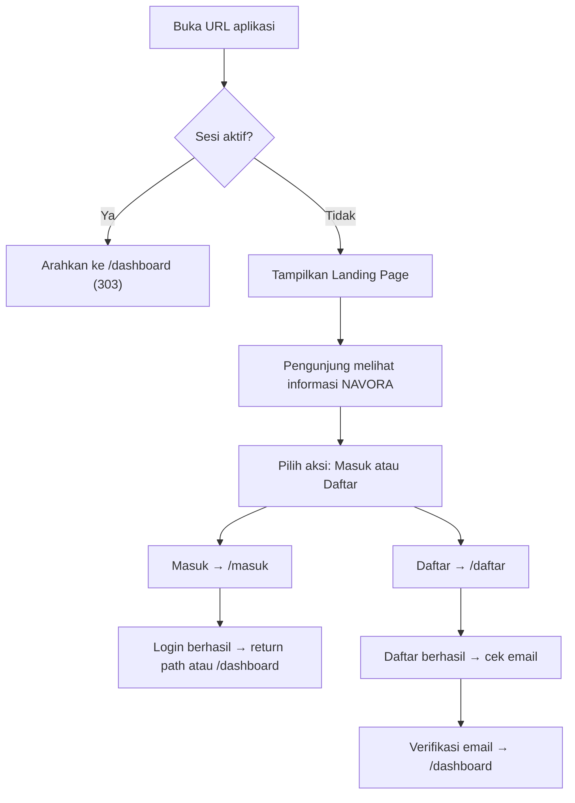

---

## UF-02 — Registration and Email Verification

**Entry:** Landing Page CTA "Daftar" → `/daftar`; or authenticated user navigating to registration.
**Outcome:** verified account with an empty active goal list; after verification, user redirected to `/dashboard`.

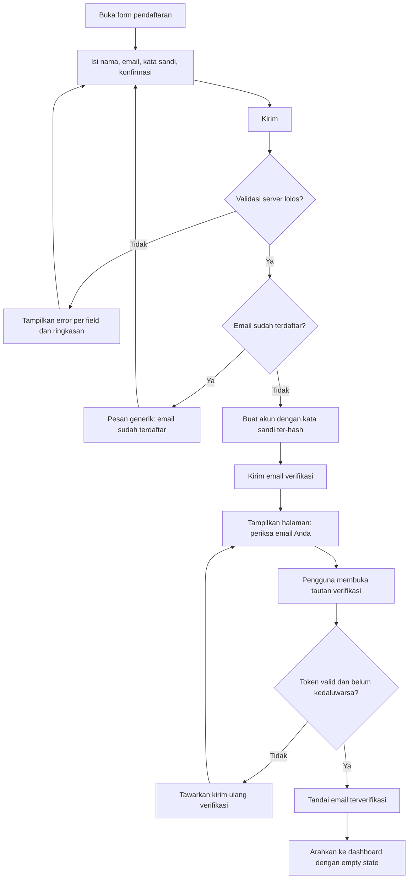

> Whether login is blocked before verification is `OPEN-08` (proposal: limited access until verified). Token lifetime is `OPEN-09` (proposal: 60 minutes).

---

## UF-03 — Login and Returning User

**Entry:** unauthenticated visit to a protected page.
**Outcome:** requested page or dashboard.

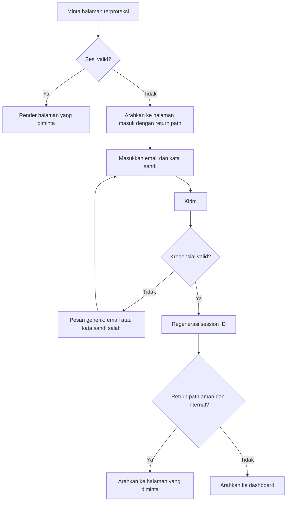

---

## UF-04 — Create Dream Goal

**Entry:** "Tambah Goal" from header, dashboard empty state, or goals list.
**Outcome:** goal created and its detail page displayed.

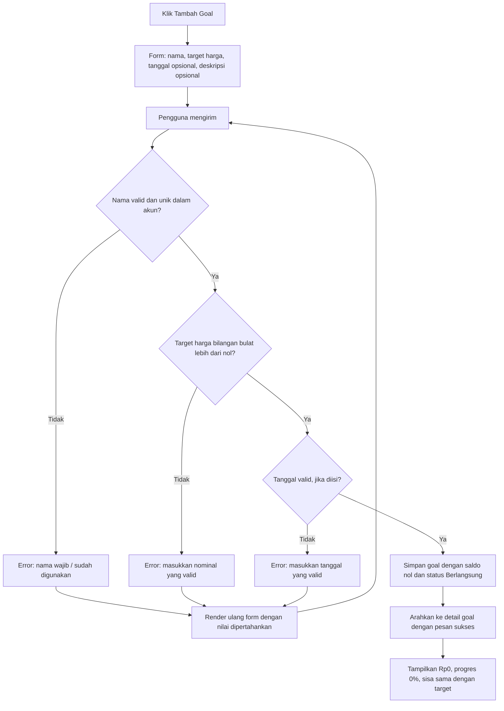

**Alternative:** user cancels → return to previous page, nothing saved. A past target date is accepted (DEC-026).

---

## UF-05 — View Goal Detail

**Entry:** select a goal from the list, dashboard, or a direct link.
**Outcome:** goal information displayed with available actions.

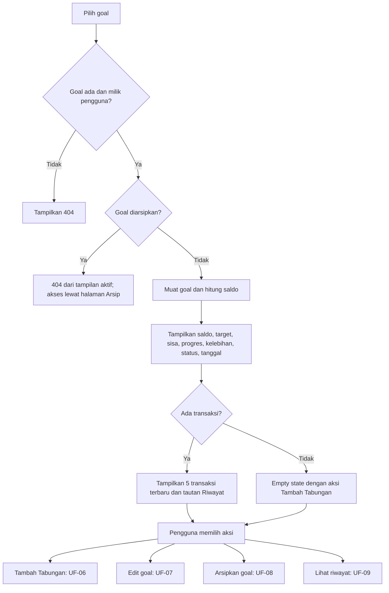

---

## UF-06 — Record Savings (Deposit or Withdrawal)

**Entry:** "Tambah Tabungan" on goal detail or dashboard activity.
**Outcome:** transaction saved, balance and status updated.

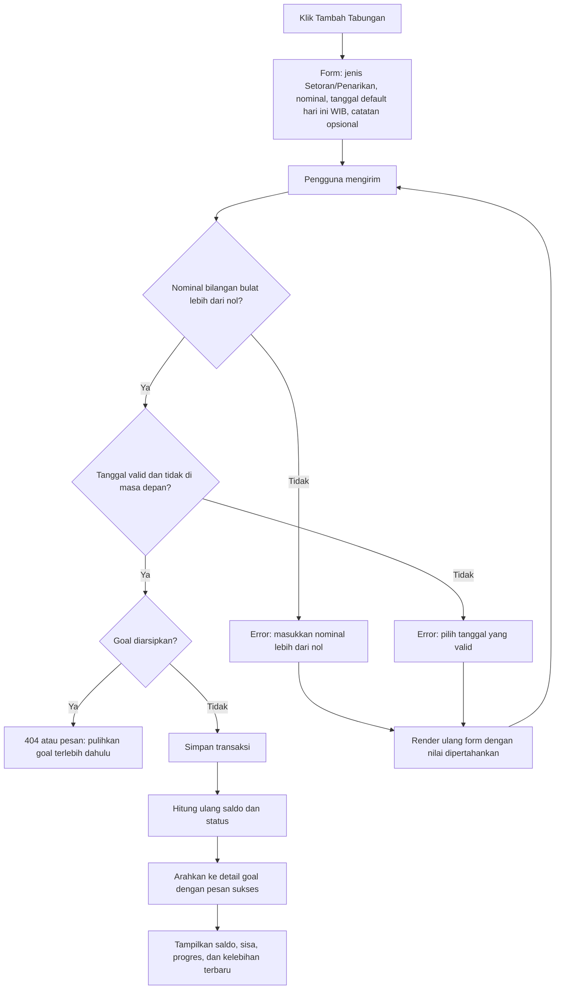

**Edge cases:**
- Withdrawal larger than the balance → accepted; balance becomes negative (DEC-025).
- Deposit that pushes balance above target → accepted; progress caps at 100% and excess is shown (DEC-023).
- Goal archived in another tab → 404 on submit, no orphan record.
- Double submit → single transaction (redirect-after-POST + request guard).

---

## UF-07 — Edit Dream Goal

**Entry:** goal detail → Edit.
**Outcome:** updated goal with recomputed balance, progress, and status.

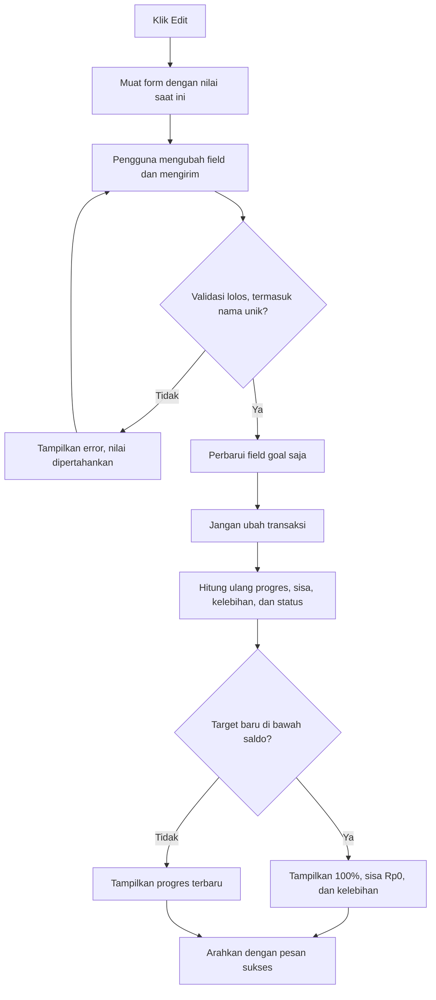

---

## UF-08 — Archive Dream Goal

**Entry:** goal detail → "Arsipkan".
**Outcome:** goal archived with history retained, or action cancelled.

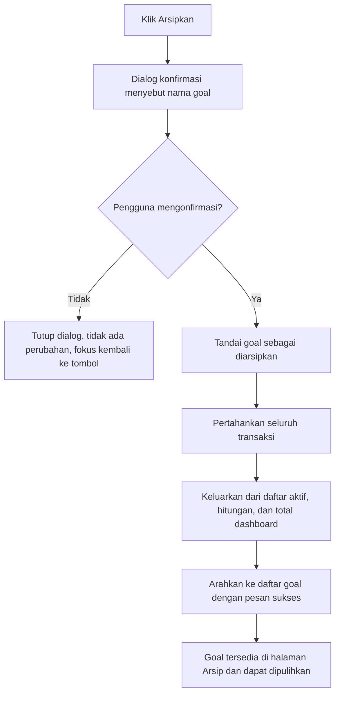

> Hard delete is not available (DEC-008).

---

## UF-09 — View Savings History & Paginate

**Entry:** goal detail → "Riwayat" or "Lihat semua".
**Outcome:** user reviews transactions across pages.

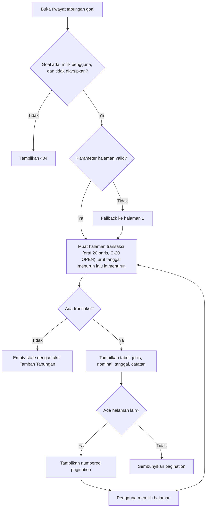

> Row-level edit/delete actions appear only if `OPEN-01`/`OPEN-02` are approved.

---

## UF-10 — Edit or Delete a Transaction (OPEN)

**Entry:** history row action (only if `OPEN-01`/`OPEN-02` are approved).
**Outcome:** corrected history with consistent balance.

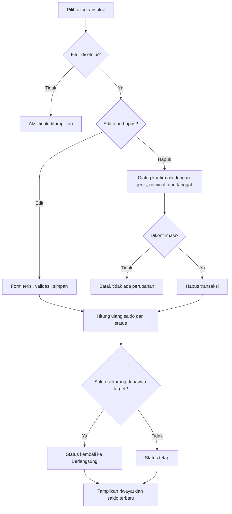

---

## UF-11 — Automatic Status & Hampir Tercapai

**Entry:** a transaction or target edit changes the balance.
**Outcome:** status and indicator reflect the new balance.

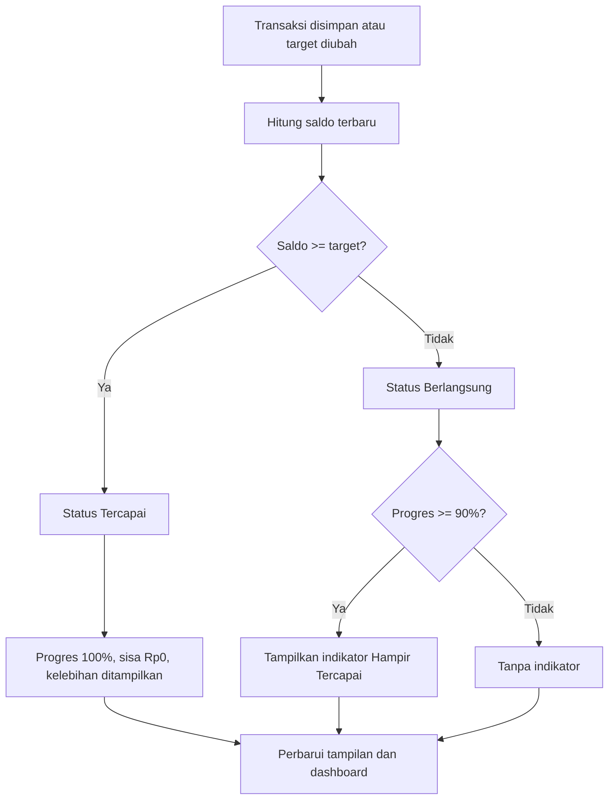

> No manual completion action exists (DEC-006). A withdrawal below target returns the status to Berlangsung automatically.

---

## UF-12 — Logout

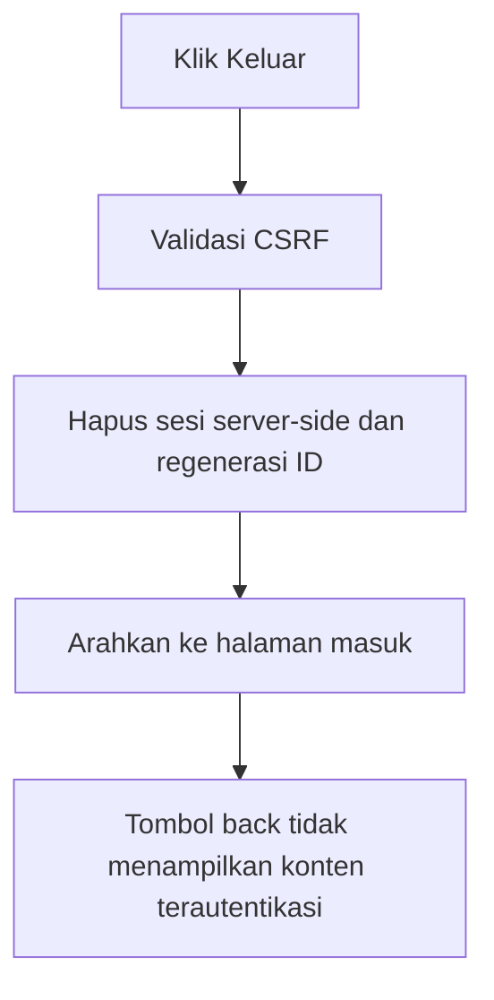

---

## UF-13 — Archive View & Restore

**Entry:** navigation → "Arsip".
**Outcome:** archived goal restored or reviewed.

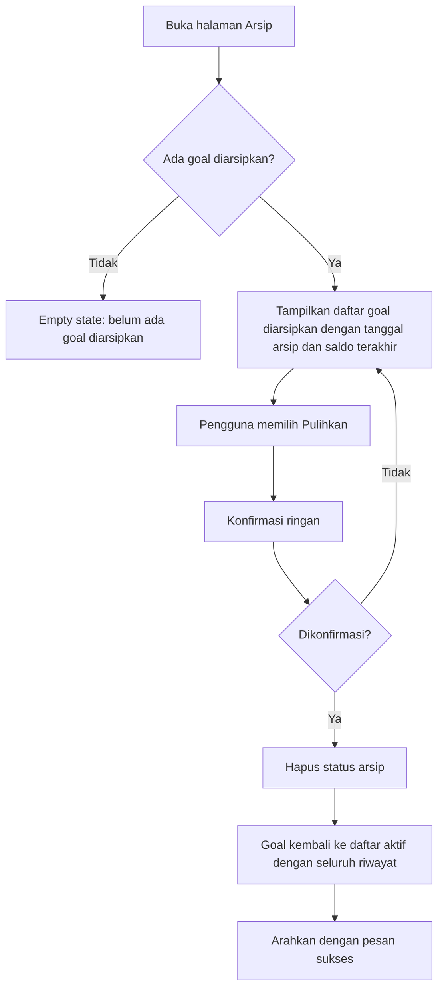

---

## UF-14 — Password Reset

**Entry:** login screen → "Lupa kata sandi".
**Outcome:** new password set and all sessions invalidated.

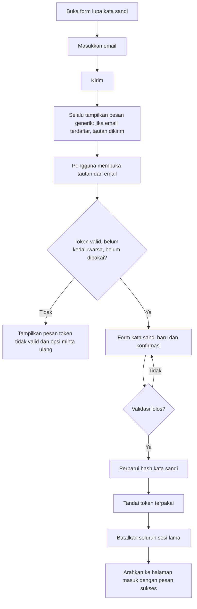

---

## Flow-to-Requirement Traceability

| Flow | Requirements |
|---|---|
| UF-01 | FR-002, FR-015, FR-026, FR-028 |
| UF-02 | FR-001, FR-036 |
| UF-03 | FR-002, FR-003 |
| UF-04 | FR-005, FR-006, FR-030, FR-039, FR-044 |
| UF-05 | FR-009, FR-021, FR-038 |
| UF-06 | FR-016, FR-018..FR-025, FR-040, FR-041 |
| UF-07 | FR-010, FR-030 |
| UF-08 | FR-011, FR-045 |
| UF-09 | FR-021, FR-023 |
| UF-10 | FR-022, FR-023 |
| UF-11 | FR-024, FR-025, FR-041 |
| UF-12 | FR-002 |
| UF-13 | FR-038, FR-045 |
| UF-14 | FR-037 |

---

## Change History (0.2.0)

- Single-user branch removed; authentication is mandatory (DEC-003).
- Registration flow extended with email verification (DEC-015); password reset flow added.
- Delete goal flow replaced with archive and restore flows (DEC-008).
- Savings flow now includes deposit/withdrawal direction and negative balances (DEC-004, DEC-025).
- Completion flow is automatic and includes Hampir Tercapai (DEC-006, DEC-012).
- Currency references updated to IDR; dates use WIB.
