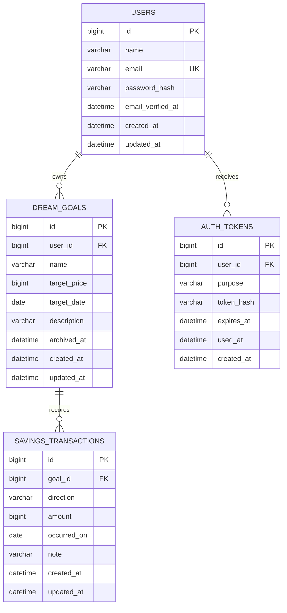

# NAVORA — Database Design

| Field | Value |
|---|---|
| Document ID | NAVORA-DB |
| Version | 0.2.0 (Consolidated) |
| Date | 2026-11-22 |
| Status | **PROPOSED — schema not created; engine and money type OPEN** |
| Related | `TECHNICAL-ARCHITECTURE.md`, `BUSINESS-RULES.md`, `DECISIONS.md` |

> **No migration has been created or executed.** `NAVORA/database/dayora.sql` remains empty. The DDL below is a design proposal for approval. Engine syntax is illustrative (MySQL/MariaDB style); the actual engine is `OPEN` (`TECH-02`).

---

## 1. Design Principles

1. **Transactions are the source of truth.** A goal's balance is always `SUM(deposits) - SUM(withdrawals)`, never a stored editable number (DEC-005).
2. **Exact money.** Whole-rupiah integers (proposed `BIGINT`), never `FLOAT`/`DOUBLE` (DEC-007, RULE-026).
3. **Referential integrity.** A transaction cannot exist without a goal.
4. **Ownership.** Every goal carries `user_id`; every query is scoped by it (DEC-003).
5. **Archive, never hard-delete.** Goals carry `archived_at`; transactions are retained (DEC-008).
6. **Auditability.** `created_at`/`updated_at` on all mutable rows; transaction dates stored as `DATE`.
7. **No speculative tables.** Habit/task/note/focus/schedule tables are **not** part of this design (DEC-016).

---

## 2. Entity Relationship Diagram



---

## 3. Tables

### 3.1 `users` (required — DEC-003)

| Column | Type | Constraints | Notes |
|---|---|---|---|
| `id` | `BIGINT UNSIGNED` | PK, AUTO_INCREMENT | |
| `name` | `VARCHAR(80)` | NOT NULL | |
| `email` | `VARCHAR(190)` | NOT NULL, UNIQUE | 190 supports utf8mb4 indexing |
| `password_hash` | `VARCHAR(255)` | NOT NULL | Output of `password_hash()` |
| `email_verified_at` | `DATETIME` | NULL | DEC-015; `NULL` = unverified |
| `created_at` | `DATETIME` | NOT NULL | UTC |
| `updated_at` | `DATETIME` | NOT NULL | UTC |

**Not included:** roles, avatars, preferences, soft-delete flag, account-deletion state.

### 3.2 `auth_tokens` (required — DEC-015)

One table for both verification and reset tokens; alternative is two tables. The choice is `OPEN` (implementation detail).

| Column | Type | Constraints | Notes |
|---|---|---|---|
| `id` | `BIGINT UNSIGNED` | PK, AUTO_INCREMENT | |
| `user_id` | `BIGINT UNSIGNED` | FK → `users.id`, NOT NULL | Index |
| `purpose` | `VARCHAR(20)` | NOT NULL | `verify_email` or `reset_password` |
| `token_hash` | `VARCHAR(255)` | NOT NULL, UNIQUE | Store a hash, never the raw token |
| `expires_at` | `DATETIME` | NOT NULL | Lifetime `OPEN-09` (proposal: 60 min) |
| `used_at` | `DATETIME` | NULL | Single-use enforcement |
| `created_at` | `DATETIME` | NOT NULL | |

### 3.3 `dream_goals`

| Column | Type | Constraints | Notes |
|---|---|---|---|
| `id` | `BIGINT UNSIGNED` | PK, AUTO_INCREMENT | |
| `user_id` | `BIGINT UNSIGNED` | FK → `users.id`, NOT NULL | Index |
| `name` | `VARCHAR(80)` | NOT NULL | RULE-002 |
| `target_price` | `BIGINT UNSIGNED` | NOT NULL, CHECK > 0 | RULE-003/004; whole IDR |
| `target_date` | `DATE` | NULL | RULE-006; past allowed (DEC-026) |
| `description` | `VARCHAR(500)` | NULL | `OPEN-03` |
| `archived_at` | `DATETIME` | NULL | DEC-008; `NULL` = active |
| `created_at` | `DATETIME` | NOT NULL | |
| `updated_at` | `DATETIME` | NOT NULL | |

**Deliberately absent:** `current_saved` (derived), `progress_percent` (derived), `status` (derived from balance, `TECH-04` proposal), `image_path` (deferred), `deleted_at` (archive uses `archived_at`).

**Uniqueness:** unique index on `(user_id, name)`. If the engine's default collation is case-insensitive, uniqueness is case-insensitive; otherwise normalization is `OPEN-14`.

### 3.4 `savings_transactions`

| Column | Type | Constraints | Notes |
|---|---|---|---|
| `id` | `BIGINT UNSIGNED` | PK, AUTO_INCREMENT | |
| `goal_id` | `BIGINT UNSIGNED` | FK → `dream_goals.id`, NOT NULL | Index |
| `direction` | `VARCHAR(10)` | NOT NULL | `deposit` or `withdrawal` (DEC-004) |
| `amount` | `BIGINT UNSIGNED` | NOT NULL, CHECK > 0 | RULE-011; always positive |
| `occurred_on` | `DATE` | NOT NULL | RULE-013 |
| `note` | `VARCHAR(255)` | NULL | `OPEN-04` |
| `created_at` | `DATETIME` | NOT NULL | Used for stable ordering |
| `updated_at` | `DATETIME` | NOT NULL | |

**Not included:** currency column (single IDR, DEC-007), attachments, running balance.

---

## 4. Proposed DDL (Illustrative Only)

```sql
-- PROPOSAL ONLY. Do not execute until approved and the engine is confirmed.
CREATE TABLE users (
  id                BIGINT UNSIGNED NOT NULL AUTO_INCREMENT,
  name              VARCHAR(80)  NOT NULL,
  email             VARCHAR(190) NOT NULL,
  password_hash     VARCHAR(255) NOT NULL,
  email_verified_at DATETIME     NULL,
  created_at        DATETIME     NOT NULL,
  updated_at        DATETIME     NOT NULL,
  PRIMARY KEY (id),
  UNIQUE KEY uq_users_email (email)
);

CREATE TABLE auth_tokens (
  id         BIGINT UNSIGNED NOT NULL AUTO_INCREMENT,
  user_id    BIGINT UNSIGNED NOT NULL,
  purpose    VARCHAR(20)  NOT NULL,
  token_hash VARCHAR(255) NOT NULL,
  expires_at DATETIME     NOT NULL,
  used_at    DATETIME     NULL,
  created_at DATETIME     NOT NULL,
  PRIMARY KEY (id),
  UNIQUE KEY uq_auth_tokens_hash (token_hash),
  KEY idx_auth_tokens_user_purpose (user_id, purpose),
  CONSTRAINT fk_auth_tokens_user FOREIGN KEY (user_id) REFERENCES users (id)
    ON DELETE CASCADE
);

CREATE TABLE dream_goals (
  id           BIGINT UNSIGNED NOT NULL AUTO_INCREMENT,
  user_id      BIGINT UNSIGNED NOT NULL,
  name         VARCHAR(80)   NOT NULL,
  target_price BIGINT UNSIGNED NOT NULL,
  target_date  DATE          NULL,
  description  VARCHAR(500)  NULL,
  archived_at  DATETIME      NULL,
  created_at   DATETIME      NOT NULL,
  updated_at   DATETIME      NOT NULL,
  PRIMARY KEY (id),
  UNIQUE KEY uq_goals_user_name (user_id, name),
  KEY idx_goals_user_archived_updated (user_id, archived_at, updated_at),
  CONSTRAINT fk_goals_user FOREIGN KEY (user_id) REFERENCES users (id)
    ON DELETE CASCADE,
  CONSTRAINT chk_goals_target_positive CHECK (target_price > 0)
);

CREATE TABLE savings_transactions (
  id          BIGINT UNSIGNED NOT NULL AUTO_INCREMENT,
  goal_id     BIGINT UNSIGNED NOT NULL,
  direction   VARCHAR(10)  NOT NULL,
  amount      BIGINT UNSIGNED NOT NULL,
  occurred_on DATE         NOT NULL,
  note        VARCHAR(255) NULL,
  created_at  DATETIME     NOT NULL,
  updated_at  DATETIME     NOT NULL,
  PRIMARY KEY (id),
  KEY idx_tx_goal_date (goal_id, occurred_on DESC, id DESC),
  CONSTRAINT fk_tx_goal FOREIGN KEY (goal_id) REFERENCES dream_goals (id)
    ON DELETE RESTRICT,
  CONSTRAINT chk_tx_amount_positive CHECK (amount > 0),
  CONSTRAINT chk_tx_direction CHECK (direction IN ('deposit', 'withdrawal'))
);
```

**Engine caveats:** `CHECK` enforcement varies (MySQL ≥ 8.0.16 enforces; older MySQL ignores). Confirm the engine before relying on checks. Application-level validation is mandatory regardless. `BIGINT UNSIGNED` for money is a proposal (`TECH-03`); `DECIMAL(18,0)` is an equivalent alternative.

**Delete behavior:** goals are archived, not deleted, so `ON DELETE RESTRICT` protects history. User deletion (not in MVP) would cascade; that policy is `OPEN` (privacy/retention).

---

## 5. Derived Values & Queries

### 5.1 Goal list with balances (avoids N+1)

```sql
SELECT g.id, g.name, g.target_price, g.target_date, g.archived_at,
       COALESCE(SUM(CASE WHEN t.direction = 'deposit' THEN t.amount
                         ELSE -CAST(t.amount AS SIGNED) END), 0) AS saved_balance
FROM dream_goals g
LEFT JOIN savings_transactions t ON t.goal_id = g.id
WHERE g.user_id = ? AND g.archived_at IS NULL
GROUP BY g.id, g.name, g.target_price, g.target_date, g.archived_at
ORDER BY g.updated_at DESC
LIMIT 20 OFFSET ?;
```

Then in PHP (single helper):
- `remaining = max(0, target - balance)`
- `progress = min(100, balance / target * 100)`
- `excess = max(0, balance - target)`
- `status = balance >= target ? 'Tercapai' : 'Berlangsung'`

### 5.2 Single goal with balance

```sql
SELECT g.*,
       COALESCE(SUM(CASE WHEN t.direction = 'deposit' THEN t.amount
                         ELSE -CAST(t.amount AS SIGNED) END), 0) AS saved_balance
FROM dream_goals g
LEFT JOIN savings_transactions t ON t.goal_id = g.id
WHERE g.id = ? AND g.user_id = ?
GROUP BY g.id;
```

### 5.3 Paginated history

```sql
SELECT id, direction, amount, occurred_on, note
FROM savings_transactions
WHERE goal_id = ?
ORDER BY occurred_on DESC, id DESC
LIMIT 20 OFFSET ?;
```

```sql
SELECT COUNT(*) FROM savings_transactions WHERE goal_id = ?;
```

### 5.4 Dashboard totals (active goals only)

```sql
SELECT
  COUNT(*) AS active_goals,
  COALESCE(SUM(saved_balance), 0) AS total_saved,
  COALESCE(SUM(GREATEST(target_price - saved_balance, 0)), 0) AS total_remaining
FROM (
  SELECT g.id, g.target_price,
         COALESCE(SUM(CASE WHEN t.direction = 'deposit' THEN t.amount
                           ELSE -CAST(t.amount AS SIGNED) END), 0) AS saved_balance
  FROM dream_goals g
  LEFT JOIN savings_transactions t ON t.goal_id = g.id
  WHERE g.user_id = ? AND g.archived_at IS NULL
  GROUP BY g.id, g.target_price
) x;
```

**Caveat:** `total_saved` may be negative if withdrawals exceed deposits across goals. That is allowed (DEC-025) and must be displayed accordingly.

---

## 6. Integrity Rules

| Rule | Enforcement |
|---|---|
| Amount > 0 | App validation + CHECK constraint |
| Direction in (`deposit`, `withdrawal`) | App validation + CHECK constraint |
| Target > 0 | App validation + CHECK constraint |
| Transaction date not in future | App validation (DB cannot use `CURRENT_DATE` portably in CHECK) |
| Goal must exist for transaction | FK |
| Transaction belongs to the same owner as its goal | Application check when loading goal |
| No orphan transactions | FK + archive-only policy |
| Balance consistency | Derived by query; no cached column |
| Status correctness | Derived from balance; no stored status (`TECH-04`) |
| Unique goal name per account | Unique index `(user_id, name)` + validation |
| Single-use auth tokens | `used_at` + `expires_at` checks in application |

---

## 7. Archive Policy (Approved — DEC-008)

| Action | Effect |
|---|---|
| Archive goal | Set `archived_at`; goal excluded from active lists/counts/totals |
| Restore goal | Clear `archived_at`; goal returns to active list |
| Transactions | Never deleted by archiving; retained and visible in archive view |
| Hard delete | Not available in MVP |

**Open:** whether transactions may be added to an archived goal (`OPEN-12`, proposal: no). Data retention/purge for archived goals (`OPEN-18`, proposal: retain indefinitely).

---

## 8. Indexing Rationale

| Index | Supports |
|---|---|
| `uq_users_email` | Login lookup, uniqueness |
| `uq_auth_tokens_hash` | Token validation |
| `idx_auth_tokens_user_purpose` | Resend/invalidations per user |
| `uq_goals_user_name` | Unique name validation |
| `idx_goals_user_archived_updated` | Active/archived list sorted by recency |
| `idx_tx_goal_date` | Paginated history, balance aggregation, recent activity |

No index is added speculatively; each maps to a documented query.

---

## 9. Naming Conventions

| Item | Convention |
|---|---|
| Tables | `snake_case`, plural (`dream_goals`, `savings_transactions`) |
| Columns | `snake_case`, singular |
| Primary key | `id` |
| Foreign key | `<entity>_id` |
| Timestamps | `created_at`, `updated_at` (UTC) |
| Dates | `_on` suffix for business dates (`occurred_on`), `_at` for timestamps |
| Booleans | `is_`/`has_` prefix (none in MVP) |

**Conflict:** the scaffold has PHP models `Goal` and `DreamSavings` but no tables. This design chooses `dream_goals` as the table and "Dream Goal" as the product term; which PHP class is authoritative is `OPEN` (C-03).

---

## 10. Data Migration & Seeding

| Item | Status |
|---|---|
| Initial schema creation | `OPEN` — not executed |
| Seed/demo data | **Not planned** — no fabricated data in shipped UI |
| Migration tooling | `OPEN` (`TECH-08`) |
| Rollback strategy | `OPEN` |
| Existing data to migrate | None (empty SQL file) |

`database/dayora.sql` should eventually be renamed and populated, but renaming requires approval (C-02).

---

## 11. Open Questions

| ID | Question | Impact |
|---|---|---|
| DB-Q1 | Database engine and version? | Types, CHECK support, syntax (`TECH-02`) |
| DB-Q2 | Money column type: `BIGINT` vs `DECIMAL(18,0)`? | Schema (`TECH-03`) |
| DB-Q3 | Status stored or derived? | Column vs query (`TECH-04`, proposal: derived) |
| DB-Q4 | Timestamps stored in UTC or WIB? | Ordering, display (`TECH-05`, proposal: UTC + WIB display) |
| DB-Q5 | Auth tokens: one table or two? | Schema shape |
| DB-Q6 | Can archived goals receive transactions? | Validation, UI (`OPEN-12`) |
| DB-Q7 | Retention/purge for archived goals? | Data policy (`OPEN-18`) |
| DB-Q8 | User account deletion policy? | FK behavior, privacy |
| DB-Q9 | Case sensitivity of unique goal names? | Collation, validation (`OPEN-14`) |
| DB-Q10 | Goal description and transaction note in MVP? | Columns (`OPEN-03`, `OPEN-04`) |

---

## 12. Traceability

| Design element | Requirement / rule |
|---|---|
| `users`, `auth_tokens` | FR-001..FR-003, FR-036, FR-037; DEC-003, DEC-015 |
| `dream_goals` | FR-005..FR-015, FR-039, FR-044; RULE-001..009 |
| `savings_transactions` | FR-016..FR-023, FR-040; RULE-010..019, RULE-051..053 |
| Derived balance/progress/excess | RULE-020..028; DEC-005, DEC-023, DEC-025 |
| Status derivation | RULE-029..034; DEC-006 |
| `archived_at` | FR-038, FR-045; RULE-033, RULE-037..040; DEC-008 |
| Unique index | FR-039; DEC-011 |
| Indexes | NFR-002, PR-03 |
