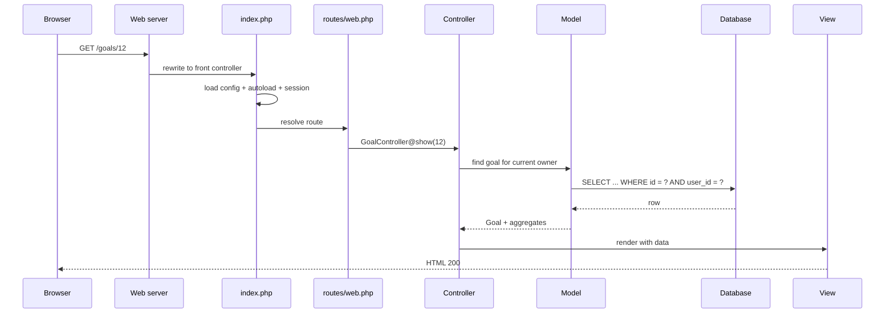
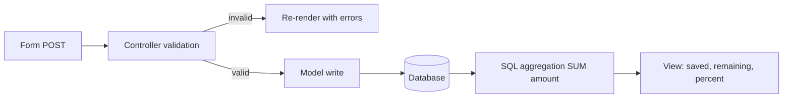

# NAVORA — Technical Architecture

| Field | Value |
|---|---|
| Document ID | NAVORA-ARCH |
| Version | 0.1 (Draft) |
| Date | 2026-11-22 |
| Status | **PARTIALLY VERIFIED — stack confirmation required** |
| Related | `DATABASE-DESIGN.md`, `API-SPECIFICATION.md`, `SECURITY-GUIDELINES.md`, `DECISIONS.md` |

## Evidence Labels

| Label | Meaning |
|---|---|
| **VERIFIED** | Directly observed in the repository |
| **INFERRED** | Deduced from file names/structure; not proven by code |
| **PROPOSED** | Drafted for approval; not implemented |
| **TBD** | Unknown; requires an owner decision |

> No dependency has been installed, upgraded, or removed. No architecture has been changed.

---

## 1. Current State — Verified Facts

| Fact | Evidence |
|---|---|
| Repository is a PHP project | 40 `.php` files, `index.php` entry point |
| Custom MVC layout, not a framework | `core/App.php`, `core/Controller.php`, `core/Database.php`, `app/controllers`, `app/models`, `app/views`; no `composer.json`, no `vendor/` |
| Server-rendered views | `app/views/**/*.php`, layout partials (`header`, `sidebar`, `footer`, `main`) |
| Plain front-end assets | `public/css/style.css`, `public/js/script.js`; no bundler, no manifest |
| Apache-style rewriting | `.htaccess` present (empty) |
| SQL schema file exists | `database/dayora.sql` (empty) |
| Environment template exists | `.env.example` (empty) |
| **Zero implementation** | All 45 files are 0 bytes |
| No tests, CI, linter, or deployment config | Absent |

**Therefore:** the "architecture" below is the *intended* structure inferred from placeholders. It has not been executed.

---

## 2. Inferred Technology Stack

| Layer | Technology | Status |
|---|---|---|
| Language | PHP | **VERIFIED** (file extension only); version `TBD` |
| Architecture | Custom MVC, front controller | **INFERRED** |
| Web server | Apache (`.htaccess`) | **INFERRED**; Nginx possible |
| Database | Relational SQL | **INFERRED**; engine `TBD` |
| DB access | Likely PDO (class named `Database`) | **INFERRED**; not verifiable |
| Templating | Native PHP includes | **INFERRED** |
| CSS | Hand-written CSS | **INFERRED** |
| JavaScript | Vanilla JS | **INFERRED** |
| Package manager | None present | **VERIFIED absent** |
| Build tooling | None present | **VERIFIED absent** |
| Testing | None present | **VERIFIED absent** |

**Not assumed:** Laravel, Symfony, CodeIgniter, React, Vue, Tailwind, Bootstrap, MySQL vs MariaDB vs PostgreSQL, Composer, npm. Any of these requires explicit approval and evidence.

---

## 3. Directory Responsibilities (as scaffolded)

```text
NAVORA/
├── index.php              # Front controller (bootstrap + dispatch)
├── .htaccess              # Rewrite all non-file requests to index.php
├── .env.example           # Environment template (keys TBD)
├── core/
│   ├── App.php            # Bootstrap, routing, dispatch
│   ├── Controller.php     # Base controller (view rendering, helpers)
│   └── Database.php       # Connection / query layer
├── config/
│   └── database.php       # DB configuration (must read env)
├── routes/
│   └── web.php            # Route table
├── app/
│   ├── controllers/       # Request handlers
│   ├── models/            # Data access / domain entities
│   └── views/             # PHP templates + layout partials
├── database/
│   └── dayora.sql         # Schema dump (legacy name)
└── public/
    ├── css/style.css
    └── js/script.js
```

### Ownership rules
- Controllers validate input, orchestrate models, choose views, and set flash messages. No SQL in controllers.
- Models own queries and business calculations.
- Views escape output and contain no queries.
- `core/` contains framework-agnostic plumbing only.

---

## 4. Proposed Request Lifecycle



**Failure branches:** unknown route → 404; unauthorized/missing record → 404; DB failure → logged 500; CSRF failure → 419.

---

## 5. Routing (Proposed)

All routes are defined in `routes/web.php`. Suggested shape:

| Method | Path | Handler | Purpose |
|---|---|---|---|
| GET | `/` | DashboardController@index | Dashboard |
| GET | `/goals` | GoalController@index | List/search |
| GET | `/goals/create` | GoalController@create | Form |
| POST | `/goals` | GoalController@store | Create |
| GET | `/goals/{id}` | GoalController@show | Detail |
| GET | `/goals/{id}/edit` | GoalController@edit | Edit form |
| POST | `/goals/{id}` | GoalController@update | Update |
| POST | `/goals/{id}/arsipkan` | GoalController@archive | Archive goal (POST + CSRF) |
| POST | `/goals/{id}/pulihkan` | GoalController@restore | Restore archived goal |
| GET | `/arsip` | GoalController@archived | Archived goals list |
| GET | `/goals/{id}/savings` | SavingsController@index | History |
| POST | `/goals/{id}/savings` | SavingsController@store | Add deposit/withdrawal |
| POST | `/savings/{id}/delete` | SavingsController@destroy | Delete transaction (`OPEN-02`) |
| GET | `/masuk` | AuthController@showLogin | Login form |
| POST | `/masuk` | AuthController@login | Authenticate |
| GET | `/daftar` | AuthController@showRegister | Registration form |
| POST | `/daftar` | AuthController@register | Create account |
| GET | `/verifikasi-email/{token}` | AuthController@verifyEmail | Verify email |
| GET | `/lupa-kata-sandi` | PasswordResetController@showRequest | Request reset |
| POST | `/lupa-kata-sandi` | PasswordResetController@send | Send reset link |
| POST | `/atur-ulang-kata-sandi` | PasswordResetController@reset | Set new password |
| POST | `/keluar` | AuthController@logout | End session |

**Design notes**
- HTML forms cannot send `PUT`/`DELETE`; use POST with an explicit action segment and a CSRF token.
- Route parameters are validated as positive integers.
- Unknown segments never fall through to a file path.
- `TBD`: whether method-spoofing (`_method`) is used.

---

## 6. Data Flow & Calculation Placement



| Calculation | Where | Why |
|---|---|---|
| Sum of transactions | SQL aggregate | Correct and efficient; avoids N+1 |
| Remaining | Model/helper | Single definition |
| Progress percent | Model/helper | Single definition, capped for display |
| Excess | Model/helper | Single definition |
| Status | Model/helper | Derived from balance (DEC-006) |
| Money formatting | View helper | Presentation concern (IDR) |
| Validation | Controller/service | Never trust the client |

No calculation is duplicated between PHP and JavaScript.

---

## 7. Error Handling Architecture

| Layer | Responsibility |
|---|---|
| Front controller | Catch unhandled exceptions; render 500; log with correlation ID |
| Router | 404 for unmatched routes |
| Controller | Validate; redirect with flash; draft convention: re-render the form with field errors using `200` (no 422 JSON in proposed MVP; `C-30` `PROPOSED`) |
| Model | Throw on DB failure; never swallow |
| View | Escape output; never display raw errors |

- Development vs production error display is controlled by an environment flag (`TBD` key name).
- Logs go outside the public webroot.
- No stack traces, SQL, or paths in production responses.

---

## 8. Authentication & Session (Required — DEC-003)

| Aspect | Proposal | Status |
|---|---|---|
| Mechanism | Server-side PHP sessions | `PROPOSED` |
| Password storage | `password_hash()` (Argon2id preferred, bcrypt fallback) | `PROPOSED` |
| Login identifier | Email | `PROPOSED` |
| Email verification | Expiring email link (DEC-015) | `APPROVED` (delivery + expiry) / `OPEN-09` (lifetime, single-use enforcement) |
| Password reset | Expiring email link; sessions invalidated (DEC-015) | `APPROVED` (delivery + expiry) / `OPEN-09` (lifetime, single-use enforcement) |
| Session fixation | `session_regenerate_id(true)` on login | `PROPOSED` |
| Cookie flags | `HttpOnly`, `SameSite=Lax`, `Secure` on HTTPS | `PROPOSED` |
| Authorization | Every query scoped by `user_id` | `APPROVED` (behavior) |
| Rate limiting | `OPEN` | `OPEN-19` |
| Session lifetime | `OPEN` | `OPEN-11` |

Authentication is mandatory. The former single-user alternative is withdrawn (DEC-003).

---

## 9. Front-End Architecture

| Concern | Approach | Status |
|---|---|---|
| Styling | One global stylesheet + token variables; component classes | `PROPOSED` |
| Layout | PHP layout partial with per-page content | `PROPOSED` |
| Interactivity | Progressive enhancement with vanilla JS (modals, menus, toasts) | `PROPOSED` |
| Validation | Server-first; optional light client hints | `PROPOSED` |
| Icons | Inline SVG sprite (Lucide) | `PROPOSED` |
| Fonts | Self-hosted, `font-display: swap` | `PROPOSED` |
| Motion | CSS transitions; GSAP not approved | `PROPOSED` / `DEFERRED` |
| Build step | None | `PROPOSED` |

---

## 10. Configuration & Environments

| Item | Status |
|---|---|
| `.env.example` keys | `TBD` — must document DB host/name/user/password, app env, app URL, session settings |
| Secret handling | `.env` ignored by git; `.env.example` contains placeholders only |
| Environment separation | `TBD` (development/production) |
| Timezone | Asia/Jakarta (WIB) for interpretation and display; storage strategy `OPEN` (`TECH-05`) | `APPROVED` (zone) |
| Locale/currency | IDR, no decimals, Bahasa Indonesia | `APPROVED` (DEC-007, DEC-013) |
| Email delivery | Provider `OPEN` (`TECH-06`) | `OPEN` |

**Note:** `NAVORA/.env.example` is currently empty; no keys are assumed beyond standard practice.

---

## 11. Deployment (Proposed, Not Performed)

| Item | Proposal | Status |
|---|---|---|
| Target | Shared PHP hosting or VPS with Apache | `TBD` |
| Document root | `NAVORA/public` ideally; currently entry is `NAVORA/index.php` | `TBD` — security-relevant |
| HTTPS | Required | `PROPOSED` |
| DB migrations | SQL file applied manually or via script | `TBD` |
| Backups | `TBD` | `TBD` |
| CI/CD | None | `TBD` |

**Risk:** with the current layout, `app/`, `config/`, `core/`, and `database/` sit above or beside the entry point. If the web root is `NAVORA/` rather than `NAVORA/public/`, source and SQL files could be exposed. This must be resolved before deployment. Recorded as a deployment risk (see §13).

---

## 12. Testing Architecture (Planned)

| Level | Tool | Status |
|---|---|---|
| Unit (calculations, validation) | `TBD` (PHPUnit requires Composer) | `TBD` |
| Integration (DB queries) | `TBD` | `TBD` |
| Feature/HTTP | `TBD` | `TBD` |
| Manual UI/responsive/a11y | Browser + keyboard + screen reader | `PROPOSED` |

No test framework is installed; installation requires approval after the requirements stage.

---

## 13. Risks & Technical Debt

| ID | Risk | Impact | Mitigation |
|---|---|---|---|
| TR-01 | Empty scaffold mistaken for working code | Wasted effort, false status | README/PROGRESS state the truth |
| TR-02 | PHP/DB versions unknown | Compatibility failures | Confirm before development |
| TR-03 | Document root exposes source/SQL | Security breach | Restructure or configure vhost before deploy |
| TR-04 | Out-of-scope modules leak into navigation | Scope creep | DEC-016 |
| TR-05 | Money stored as float | Rounding errors | DECIMAL/integer minor units (RULE-026) |
| TR-06 | N+1 balance queries | Slow lists | Aggregate in SQL |
| TR-07 | No CSRF protection in a hand-rolled MVC | Data tampering | Central CSRF helper |
| TR-08 | Hand-rolled routing/autoloading bugs | Fragile app | Keep core small, test routing |
| TR-09 | No dependency manager | Manual autoloading | Explicit autoloader in `App.php` |
| TR-10 | Legacy `dayora.sql` name | Confusion | Rename after approval |

---

## 14. Architecture Decisions Pending

| Decision | Record |
|---|---|
| Confirm PHP MVC baseline | `DEC-002` (`PENDING`) |
| Authentication model | Resolved: multi-user (DEC-003) |
| Email verification and password reset | DEC-015; delivery `TECH-06` |
| Database engine | `OPEN` (`TECH-02`) |
| Money column type | `OPEN` (`TECH-03`) |
| Status storage | `OPEN` (`TECH-04`) |
| Document root strategy | `OPEN` (`TECH-09`) |
| API vs server-rendered | `DEC-017` (`PENDING`) |
| GSAP adoption | DEC-020 |

---

## 15. Traceability

| Architecture element | Evidence |
|---|---|
| Front controller | `NAVORA/index.php` |
| MVC layers | `core/`, `app/controllers`, `app/models`, `app/views` |
| Routing file | `routes/web.php` |
| DB layer | `core/Database.php`, `config/database.php`, `database/dayora.sql` |
| Assets | `public/css/style.css`, `public/js/script.js` |
