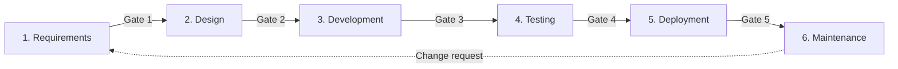

# NAVORA — Roadmap (Waterfall)

| Field | Value |
|---|---|
| Document ID | NAVORA-ROADMAP |
| Version | 0.1 (Draft) |
| Date | 2026-11-22 |
| Status | **AWAITING REQUIREMENTS APPROVAL** |
| Methodology | Waterfall with formal stage gates (proposed `DEC-022`; `DEC-014` is the WIB timezone decision) |

> No stage may begin until the previous stage is reviewed and approved by the project owner. Durations are intentionally `TBD` — no schedule, budget, or team capacity has been provided.

---

## Stage Overview

| # | Stage | Current state | Gate |
|---|---|---|---|
| 1 | Requirements | **In progress** — documents drafted, awaiting approval | G1 |
| 2 | Design | Not started (drafts exist as proposals) | G2 |
| 3 | Development | Not started — 0% implemented | G3 |
| 4 | Testing | Not started — plan only | G4 |
| 5 | Deployment | Not started | G5 |
| 6 | Maintenance | Not started | — |

---

## Stage 1 — Requirements

**Objective:** Establish an approved, unambiguous product scope and rule set.

**Activities**
- Audit repository and existing documentation (complete).
- Draft BRD, PRD, SRS, business rules, feature specifications (complete as drafts).
- Apply owner-approved decisions (DEC-003/004/006/007/008/016/023..026); see `DECISIONS.md` §1.
- Triage remaining `OPEN` items (`DECISIONS.md` §4/§5) without silently resolving them.
- Review with the owner and obtain sign-off.

**Deliverables**
- `docs/01-product/BRD.md` (approved)
- `docs/01-product/PRD.md` (approved)
- `docs/01-product/SRS.md` (approved)
- `docs/01-product/BUSINESS-RULES.md` (approved)
- `docs/01-product/FEATURE-SPECIFICATION.md` (approved)
- `docs/04-project-management/DECISIONS.md` with no blocking `TBD` for MVP scope

**Exit criteria (G1)**
- [ ] All `Must` requirements approved.
- [ ] Owner-approved decisions recorded as binding (`DECISIONS.md` §1).
- [ ] Scope exclusions confirmed (DEC-016).
- [ ] Remaining `OPEN` items triaged; none silently treated as approved.
- [ ] Owner signs off on MVP scope (DEC-024) and the requirements package.

**Blocking questions:** none unresolved from the original Q-01..Q-08 set (all resolved in `PRD.md` §12). Remaining items are tracked in `DECISIONS.md` §4.

---

## Stage 2 — Design

**Objective:** Finalize the design system, component contracts, wireframes, and technical design before coding.

**Activities**
- Approve palette, typography, icon library (DEC-010, DEC-019).
- Review wireframes for dashboard, goals, detail, history, forms, states.
- Finalize component specifications and responsive behavior.
- Confirm database engine and schema; review ERD.
- Confirm security approach and deployment target.
- Optional: create high-fidelity mockups (not produced by AI without request).

**Deliverables**
- Approved `docs/02-design/*`
- Approved `docs/03-technical/*`
- Approved schema DDL (not executed)
- Accessibility checklist accepted

**Exit criteria (G2)**
- [ ] Design tokens approved.
- [ ] All MVP screens have approved wireframes.
- [ ] Component contracts accepted.
- [ ] Schema and route table approved.
- [ ] Security guidelines accepted.
- [ ] No unresolved decision that changes the data model.

---

## Stage 3 — Development

**Objective:** Implement the approved MVP in the existing PHP MVC scaffold.

**Suggested work order**
1. Environment/config, front controller, autoloader, error handling.
2. Database connection + schema (after approval).
3. Layout, design tokens, base components.
4. Goals CRUD.
5. Savings transactions + balance/progress calculation.
6. Dashboard aggregation.
7. Validation, CSRF, escaping, feedback states.
8. Authentication (mandatory — DEC-003), including email verification and password reset (DEC-015).
9. Responsive and accessibility passes.
10. Remove/exclude out-of-scope routes.

**Deliverables**
- Working MVP matching approved requirements.
- Updated `PROGRESS.md`, `DECISIONS.md`, `CHANGELOG.md`.
- Test evidence for each feature.

**Exit criteria (G3)**
- [ ] All `Must` requirements implemented.
- [ ] No known critical defects.
- [ ] Definition of Done met per feature (`docs/05-quality/DEFINITION-OF-DONE.md`).
- [ ] No out-of-scope features added.

**Not permitted:** framework migration, unapproved dependencies, scope expansion.

---

## Stage 4 — Testing

**Objective:** Verify correctness, usability, accessibility, and security against approved criteria.

**Activities**
- Execute the test plan (`docs/05-quality/TESTING-PLAN.md`).
- Record actual results; never mark unexecuted tests as passed.
- Fix defects and retest.
- Manual responsive and keyboard testing.
- Security checks from `SECURITY-GUIDELINES.md` §13.

**Deliverables**
- Executed test results with evidence.
- Defect log and resolutions.
- Updated acceptance criteria status.

**Exit criteria (G4)**
- [ ] All `Must` acceptance criteria pass.
- [ ] No open critical/high defects.
- [ ] Balance calculations verified against independent expectations.
- [ ] Accessibility checks completed with documented findings.
- [ ] Test report approved.

---

## Stage 5 — Deployment

**Objective:** Release the approved build to the target environment safely.

**Activities**
- Confirm hosting, PHP version, DB engine.
- Configure document root so source/config/SQL are not web-accessible.
- Apply schema; configure environment variables.
- Enable HTTPS, security headers, production error handling.
- Smoke test the deployed application.
- Prepare rollback.

**Deliverables**
- Deployment checklist completed.
- Smoke test evidence.
- Rollback procedure.
- Release notes.

**Exit criteria (G5)**
- [ ] Deployed app passes smoke tests.
- [ ] No secrets exposed.
- [ ] Backups configured.
- [ ] Owner acceptance.

---

## Stage 6 — Maintenance

**Objective:** Keep the product correct and secure after release.

**Activities**
- Monitor errors and feedback.
- Apply security patches.
- Fix defects.
- Evaluate future candidates (`PRD.md` §11) through change requests.

**Deliverables**
- Maintenance log.
- Change requests with impact analysis.
- Updated documentation for every change.

**Exit criteria:** ongoing.

---

## Milestones

| ID | Milestone | Depends on | Status |
|---|---|---|---|
| M1 | Documentation foundation complete | This phase | **Draft complete — awaiting approval** |
| M2 | Requirements approved (G1) | Owner review | Not started |
| M3 | Design approved (G2) | M2 | Not started |
| M4 | MVP implemented (G3) | M3 | Not started |
| M5 | Testing complete (G4) | M4 | Not started |
| M6 | Deployed (G5) | M5 | Not started |

---

## Risks to the Schedule

| Risk | Effect | Mitigation |
|---|---|---|
| Unresolved financial rules | Blocks development start | Resolve at G1 |
| Authentication indecision | Rework of schema and flows | Resolve at G1 |
| Scope creep from legacy modules | Delays MVP | DEC-016 |
| Single-developer capacity | Slower stages | Small, reviewable increments |
| Environment mismatch (PHP/DB) | Late integration failures | Confirm stack at G2 |

---

## Change Control

Any change after G1 requires:
1. A written change request.
2. Impact analysis on requirements, design, schema, and tests.
3. Owner approval recorded in `DECISIONS.md`.
4. Updated documentation before implementation.
